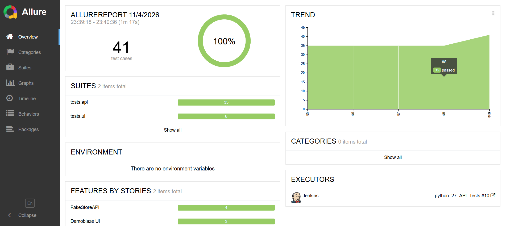
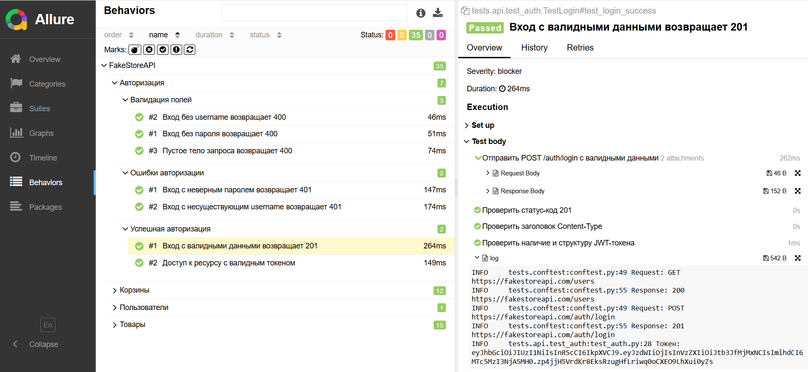
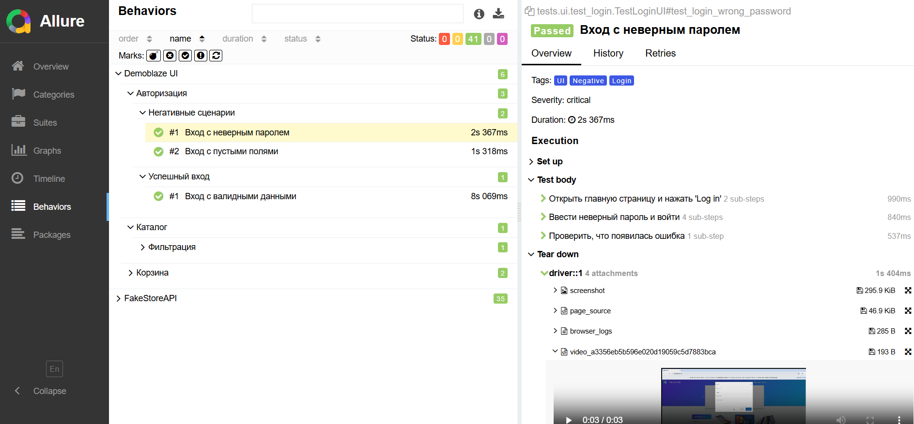
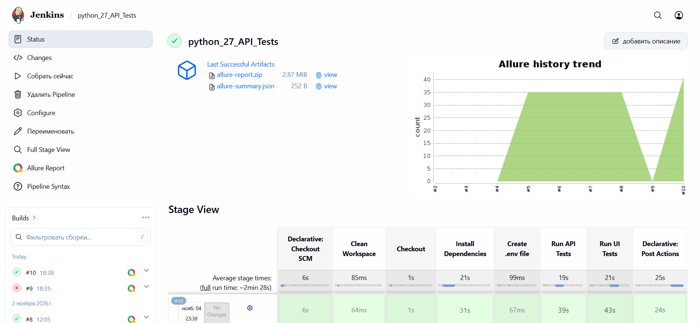

# 🛒 QA Automation Project: FakeStoreAPI & Demoblaze

**Проект по автоматизации тестирования API и UI** с использованием Python, Requests, Selenium, Pytest, Allure и Selenoid.


---

## 🚀 Установка
Клонируйте репозиторий, создайте и активируйте виртуальное окружение, установите зависимости.

```bash

git clone https://github.com/alagunskaya/qa_guru_diplom.git
cd qa_guru_diplom
```
```bash
python -m venv .venv
source .venv/bin/activate      # Linux / macOS
.venv\Scripts\activate         # Windows
```
```bash
pip install -r requirements.txt
```
## 🧪 Запуск тестов
Проект разделен на API и UI тесты, чтобы вы могли запускать их как вместе, так и по отдельности.

**Только API-тесты (локально):**
```bash
pytest tests/api
```
**Только UI-тесты (локально):**
```bash
pytest tests/ui
```
**UI-тесты в Selenoid (с записью видео):**
```bash
pytest tests/ui --selenoid
```
**Все тесты:**
```bash
pytest tests/api; pytest tests/ui
```
## 📊 Генерация Allure-отчёта

```bash
# Запуск всех тестов с сохранением результатов в одну папку
pytest tests/api --alluredir=allure-results
pytest tests/ui --alluredir=allure-results --selenoid

# Генерация и открытие отчёта
allure generate allure-results -o allure-report --clean
allure open allure-report
```
### 💡 Что вы увидите в отчёте:
- Разделение тестов по эпикам: FakeStoreAPI и Demoblaze UI
- Скриншоты, HTML-код страницы, логи браузера и видео (для UI-тестов в Selenoid)
- Логи HTTP-запросов и ответов (для API-тестов)
- Наглядную структуру шагов через allure.step()

### 🔴 Просмотр тестов в Selenoid
```bash
UI: https://selenoid.qa.guru/ui/
```
### 🧪 Покрытие тестами
#### API Тесты (FakeStoreAPI)
| Модуль | Что покрывает |
| :--- | :--- |
| `tests/api/test_users.py` | Список пользователей, наличие тестового аккаунта |
| `tests/api/test_auth.py` | Авторизация (JWT): успешный логин, неверные данные, отсутствующие поля (400/401) |
| `tests/api/test_products.py` | Список товаров, валидация по JSON-схеме, получение по ID, категории, фильтрация, `limit`, `sort` |
| `tests/api/test_products_crud.py` | CRUD товара: создание (201), обновление (200), удаление (200) |
| `tests/api/test_carts.py` | Список корзин, валидация по схеме, корзины по `userId`, интеграционная проверка `productId` |
| `tests/api/test_carts_crud.py` | CRUD корзины: создание (201), обновление (200), удаление (200) |
#### UI Тесты (Demoblaze)
| Модуль | Что покрывает                                                             |
| :--- |:--------------------------------------------------------------------------|
| `tests/ui/test_login.py` | Авторизация: успешный вход, неверный пароль, пустые поля (проверка alert) |
| `tests/ui/test_catalog.py` | Фильтрация по категории                                         |
| `tests/ui/test_cart.py` | Добавление товара в корзину, проверка пустой корзины                      |

#### 🤖 CI/CD (Jenkins)
Проект настроен и запускается через Jenkins (Pipeline).

**Сборка автоматически выполняет следующие шаги:**
- Клонирование репозитория
- Установка зависимостей
- Создание файла .env
- Запуск API-тестов
- Запуск UI-тестов в Selenoid
- Генерация общего Allure-отчёта (содержит результаты и API, и UI тестов)

### Отчёт Allure




### Успешная сборка в Jenkins


### Пример видеозаписи прохождения теста
