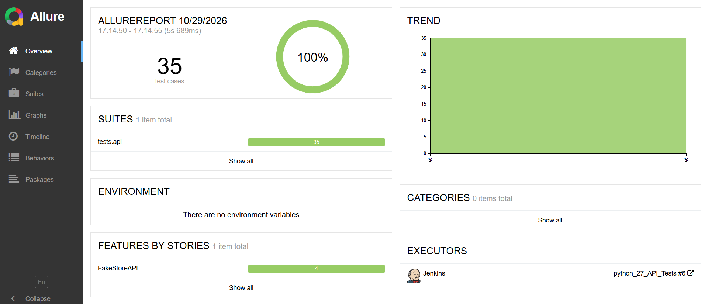
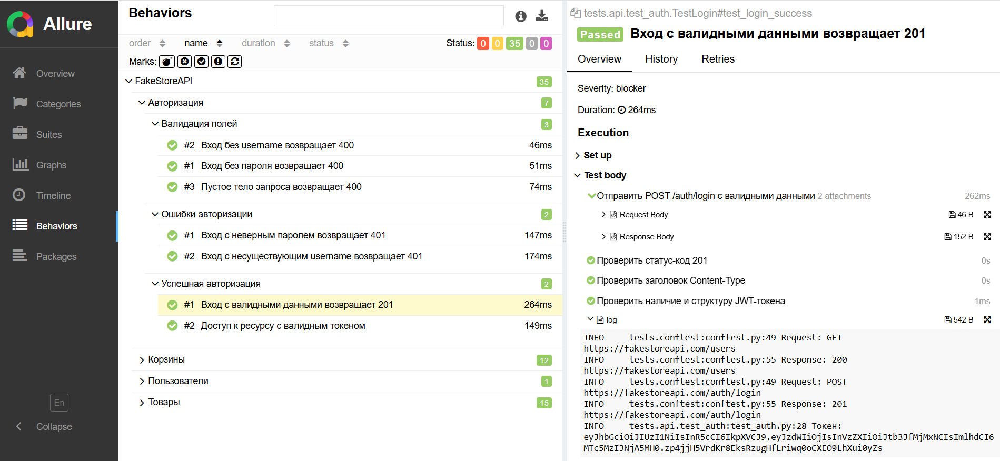
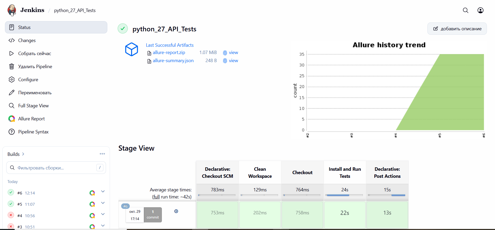

# 🛒 API Tests для FakeStoreAPI

Проект автоматизации тестирования публичного FakeStoreAPI с использованием Python, библиотеки `requests` и фреймворка `pytest`.

**Цель проекта:** демонстрация практических навыков написания API-тестов, работы с JSON-схемами, параметризации, использования фикстур и генерации отчётов.

## 🧪 Тесты

| Файл | Что покрывает |
|---|---|
| `tests/api/test_users.py` | Список пользователей, наличие тестового аккаунта |
| `tests/api/test_auth.py` | Авторизация (JWT): успешный логин, неверные данные, отсутствующие поля (400/401) |
| `tests/api/test_products.py` | Список товаров, валидация по JSON-схеме, получение по ID, 404/пустое тело, категории, фильтрация, limit, sort, рейтинг |
| `tests/api/test_products_crud.py` | CRUD товара: создание (201), обновление (200), удаление (200) |
| `tests/api/test_carts.py` | Список корзин, валидация по схеме, корзины по userId (параметризация), интеграционная проверка productId |
| `tests/api/test_carts_crud.py` | CRUD корзины: создание (201), обновление (200), удаление (200) |

## ⚙️ Особенности реализации

- **Логирование:** все HTTP-запросы и ответы автоматически логируются в консоль (дата, время, URL, статус-код) и прикрепляются к Allure-отчету (`request` / `response`).
- **Валидация:** для всех ответов (response) и тел запросов (request) на создание/обновление используются JSON-схемы.
- **CI/CD:** настроен `Jenkinsfile` для автоматического запуска тестов и генерации Allure-отчёта в пайплайне.

## 🚀 Установка и запуск тестов

```bash
# клонировать репозиторий
git clone <ссылка-на-репозиторий>
cd <папка-проекта>

# создать и активировать виртуальное окружение
python -m venv .venv
source .venv/bin/activate      # Linux / macOS
.venv\Scripts\activate         # Windows

# установить зависимости
pip install -r requirements.txt

# запустить тесты
python -m pytest tests/ -v
```

## 📊 Генерация Allure-отчёта

```bash
# запустить тесты с сохранением результатов
python -m pytest tests/ --alluredir=allure-results

# открыть отчет в браузере
allure serve allure-results
```

### Отчёт Allure



### Успешная сборка в Jenkins
